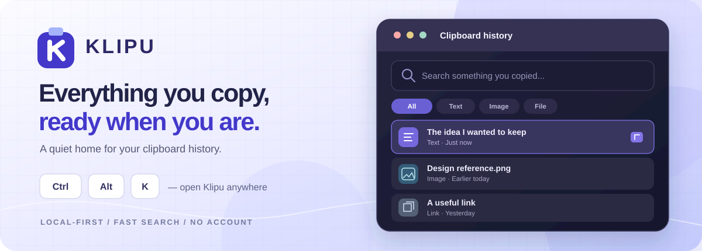
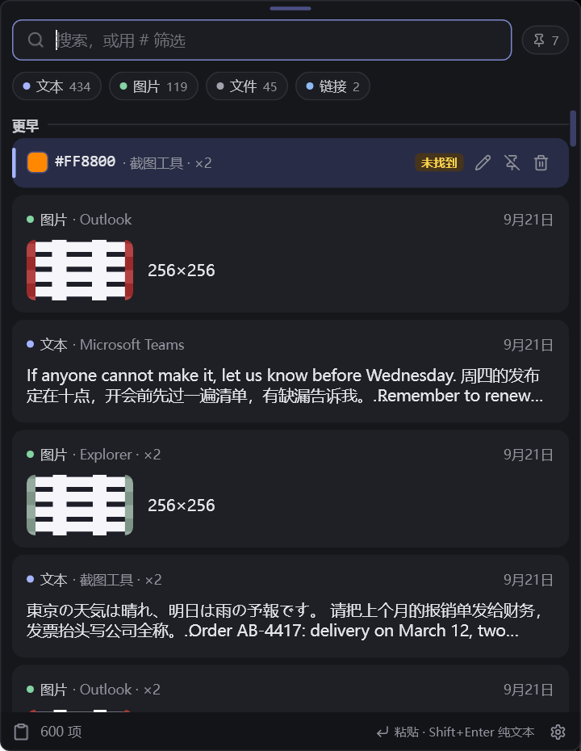

  

<h1 align="center">Klipu</h1>

  <strong>Copy it once. Find it whenever.</strong> 
  A focused clipboard manager for Windows. Your text, images, files and links — a shortcut away.

  
  
  
  

  <a href="https://github.com/seiya058904/Klipu/releases/latest"><strong>↓ Download for Windows</strong></a>
  &nbsp;·&nbsp; <a href="#preview">Screenshots</a>
  &nbsp;·&nbsp; <a href="#features">Features</a>
  &nbsp;·&nbsp; <a href="#download">Get started</a>
  &nbsp;·&nbsp; <a href="#shortcuts">Shortcuts</a>
  &nbsp;·&nbsp; <a href="#development">Build</a>

No account · No automatic updates · No network requests from Klipu · 简体中文 &amp; English

---

## 🪟 One shortcut. Your whole clipboard.

Press <kbd>Ctrl</kbd> + <kbd>Alt</kbd> + <kbd>K</kbd> wherever you're working. Klipu opens over your current app. Search, choose an item, press <kbd>Enter</kbd> — and get back to what you were doing.

<table>
  <tr>
    <td width="50%" align="center" valign="top">
      
    </td>
    <td width="50%" align="center" valign="top">
      
    </td>
  </tr>
  <tr>
    <td align="center"><strong>Keep everything in reach</strong> Clipboard history · Dark mode</td>
    <td align="center"><strong>Find the little things fast</strong> Chinese text search · Light mode</td>
  </tr>
</table>

Actual Klipu captures · Click either image to view it full size. The cover above is an illustration, not a screenshot.

## ✨ The useful bits, without the extras

<table>
  <tr>
    <td width="50%" valign="top">
      <strong>📋 Keep what you copy</strong>  
      Text, images, files, folders and links live in one searchable history. Duplicate copies merge and move to the top.
    </td>
    <td width="50%" valign="top">
      <strong>🔎 Find it in a few keystrokes</strong>  
      Search inside Chinese sentences, Japanese kana and mixed text; ignore Latin accents. Windows OCR also makes text inside screenshots searchable.
    </td>
  </tr>
  <tr>
    <td valign="top">
      <strong>⚡ Paste, pin, reuse</strong>  
      Paste normally or as plain text. Pin favorites, give items names, and drag images or files into other apps.
    </td>
    <td valign="top">
      <strong>🌙 Stay out of the way</strong>  
      Light and dark themes, a tray icon, start-at-login, automatic history cleanup, and local backup and restore. No account or updater.
    </td>
  </tr>
</table>

**A few deliberate choices:** four simple filters (Text, Image, File, Link), two interface languages, and no online services to set up.

## 📦 Download. Install. Copy.

**[Get the latest release →](https://github.com/seiya058904/Klipu/releases/latest)**

| Current release · v1.0.0 | Download |
| :-- | :-- |
| **Windows x64 installer** | [Klipu_1.0.0_x64-setup.exe](https://github.com/seiya058904/Klipu/releases/download/v1.0.0/Klipu_1.0.0_x64-setup.exe) |
| **File integrity** | [SHA256SUMS](https://github.com/seiya058904/Klipu/releases/download/v1.0.0/SHA256SUMS) |

1. Download and run the installer. It installs for your Windows user account **without administrator rights**.
2. Press <kbd>Ctrl</kbd> + <kbd>Alt</kbd> + <kbd>K</kbd> to open Klipu.
3. Copy as usual. Your recent clips are now easy to search and reuse.

**Requirements:** Windows 10 version 1809 or later, or Windows 11; x64. Klipu uses Microsoft's WebView2 runtime, which the installer sets up if missing. Future updates are installed manually over the current version; your history is retained.

<strong>🛡️ Unsigned installer and SHA-256 verification</strong>

Klipu's installer is **not code-signed**, so Windows SmartScreen may show a warning. Download it from the official release, compare its SHA-256 hash against the included `SHA256SUMS`, and proceed only if you trust the file. If verified and you choose to run it, Windows may offer **More info → Run anyway**.

~~~powershell
Get-FileHash .\Klipu_1.0.0_x64-setup.exe -Algorithm SHA256
~~~

## ⌨️ Quick to open, quicker to use

| Shortcut | What it does |
| :-- | :-- |
| <kbd>Ctrl</kbd> + <kbd>Alt</kbd> + <kbd>K</kbd> | Open Klipu from anywhere |
| <kbd>Ctrl</kbd> + <kbd>Alt</kbd> + <kbd>Shift</kbd> + <kbd>K</kbd> | Paste the latest clip as plain text |
| <kbd>Enter</kbd> / <kbd>Shift</kbd> + <kbd>Enter</kbd> | Paste / paste as plain text in the panel |
| <kbd>↑</kbd> <kbd>↓</kbd> | Browse your history |
| <kbd>Esc</kbd> | Close the panel |

<strong>More shortcuts, filters and customization</strong>

| In the panel | Action |
| :-- | :-- |
| <kbd>Tab</kbd> / <kbd>Shift</kbd> + <kbd>Tab</kbd> | Move through filters |
| `#image`, `#图片`, `#file`, `#link` | Filter directly from search |
| <kbd>→</kbd> | Expand or collapse an item |
| <kbd>Ctrl</kbd> + <kbd>P</kbd> | Pin or unpin an item |
| <kbd>F2</kbd> / <kbd>Ctrl</kbd> + <kbd>E</kbd> | Name an item |
| <kbd>Ctrl</kbd> + <kbd>O</kbd> | Open with the default app |
| <kbd>Delete</kbd> | Delete an item when search is empty |
| <kbd>Ctrl</kbd> + <kbd>1</kbd> / <kbd>Ctrl</kbd> + <kbd>2</kbd> | All items / pinned only |
| <kbd>F1</kbd> | Open Settings |

You can change global shortcuts in Settings. When another app has already claimed one, Klipu can suggest available alternatives.

## 🔒 Your history stays yours

Klipu makes **no network requests of its own**: no accounts, telemetry, analytics, update checks or cloud sync. Your history, stored images, settings and logs live under `%LOCALAPPDATA%\Klipu`. OCR runs locally through Windows.

Klipu does not read content that another app marks as excluded from clipboard history, as many password managers do. **This is not encryption:** clipboard history and backups are unencrypted, and passwords copied from ordinary apps can still be saved. Treat backups as sensitive files.

See [Privacy](PRIVACY.md) for stored data and controls, and [Security](SECURITY.md) for private vulnerability reports.

## 🌱 Built on CoPanda, made simpler

Klipu is an independent modification of **[CoPanda](https://github.com/rgdevment/CopyPaste)** by Mario Hidalgo G. (rgdevment), based on v3.4.0. It keeps CoPanda's mature clipboard engine while focusing the experience on Windows, everyday formats and fast retrieval.

Klipu has its **own app identity, data folder, installer and shortcuts**. It can coexist with CoPanda without reading or changing its data, and it can import a CoPanda `.cpbackup` file when you explicitly choose one. The projects are not affiliated. Full attribution: [NOTICE.md](NOTICE.md).

<strong>What changed from CoPanda?</strong>

| | CoPanda | Klipu |
| :-- | :-- | :-- |
| Platform | Windows and macOS | **Windows only** |
| Interface languages | Spanish and English | **简体中文 and English** |
| Search in Chinese | Whole runs of characters | **Any exact substring** |
| Paste | Plain text and extra conversions | **Original or plain text** |
| Filters | Up to 15 kinds, multiple views | **Text, Image, File, Link** |
| Audio/video | Rich media cards and waveforms | **File cards with thumbnails when available** |
| Online updater | Available | **Removed; no app-initiated requests** |

The stored history can still contain formats that no longer have a separate filter. Those items remain readable and usable.

## 🛠️ Build from source

**Rust · Tauri 2 · Slint · React · SQLite / FTS5**

On Windows, install the [Rust toolchain](https://rustup.rs), Visual Studio Build Tools (C++ workload and Windows SDK), Node.js 24 and Python 3.

~~~powershell
cd app
npm ci
cd ..
py scripts/sidecar.py
cd app
npx tauri build --bundles nsis --no-sign
~~~

The installer is written to `target/release/bundle/nsis/`.

<strong>Run checks and explore the architecture</strong>

From the repository root:

~~~powershell
cargo fmt --all --check
py scripts/sidecar.py --debug
cargo clippy --workspace --all-targets
cargo test --workspace
bash scripts/rules.sh
cd app; npm run lint; npm run build; npm test
~~~

A Tauri 2 process owns the tray, global shortcuts and React settings window. A separate Slint panel handles the history interface and clipboard watching. `cp-store` manages SQLite / FTS5 history; `cp-core` contains platform-independent logic; `cp-win` and `cp-win-sys` provide Windows integration.

For development conventions, see [CONTRIBUTING.md](CONTRIBUTING.md).

<strong>Known limitations</strong>

- Klipu cannot paste directly into windows running as administrator unless Klipu also runs as administrator. The content remains on the clipboard for manual pasting.
- OCR uses the languages installed in Windows. Chinese text in images needs the Chinese OCR language feature.
- CJK search matches exact adjacent characters, not word variations.
- The installer is unsigned and updates are manual.

<strong>简体中文 · 快速了解</strong>

**Klipu 是一款轻量、专注的 Windows 剪贴板管理器。** 支持文字、图片、文件、文件夹和链接历史记录，可搜索中文句子中的任意连续片段，还能利用 Windows 自带的 OCR 搜索截图文字。

按 **Ctrl + Alt + K** 呼出面板，搜索并回车粘贴；支持收藏置顶、纯文本粘贴、深浅色主题和本地备份。**无需账号，不主动联网，也不包含自动更新。**

从 [Releases](https://github.com/seiya058904/Klipu/releases/latest) 下载安装程序。请注意：**历史记录和备份均未加密**，普通应用复制的密码可能进入历史记录。

## License & credits

Klipu is distributed under **[GPL-3.0-only](LICENSE)**. © 2026 Mario Hidalgo G. (rgdevment) for CoPanda; © 2026 Klipu contributors for modifications. See [NOTICE.md](NOTICE.md) and [third-party licenses](THIRD-PARTY.md). The clipboard panel uses [Slint](https://slint.dev).

---

   
  <em>Less searching. More doing.</em> 
  <a href="https://github.com/seiya058904/Klipu/releases/latest"><strong>Download Klipu</strong></a>
  &nbsp;·&nbsp; <a href="https://github.com/seiya058904/Klipu/issues">Feedback</a>
  &nbsp;·&nbsp; <a href="#top">Back to top ↑</a>

